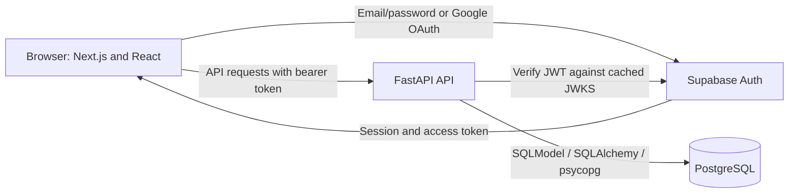
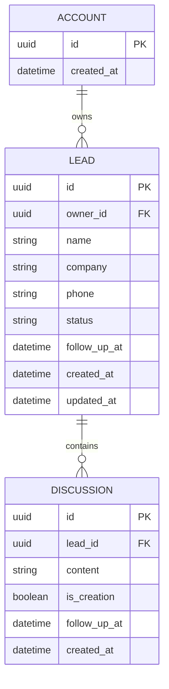
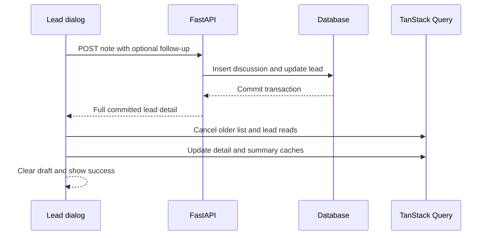

# LeadFlow — Project Architecture and Guide

## Project overview

LeadFlow is a single-screen CRM built for the PravarAI fullstack assessment.
Each user gets a private workspace for leads, conversation history, pipeline
statuses, and scheduled follow-ups. The dashboard highlights who needs attention
today and the context of the latest conversation.

| Capability      | Behavior                                                                 |
| --------------- | ------------------------------------------------------------------------ |
| Authentication  | Email/password and Google through Supabase Auth                          |
| Lead management | Required name, optional company and phone; default status New            |
| Pipeline        | New, Contacted, Qualified, Proposal Sent, Won, Lost                      |
| Discovery       | Name search and status filters without a page reload                     |
| History         | Newest-first notes and historical follow-up dates                        |
| Follow-ups      | Today's reminders pinned once; overdue reminders highlighted             |
| Onboarding      | Six leads across all statuses and thirteen timeline entries, seeded once |
| Local preview   | Explicit demo identity with persistent local data                        |

## Architecture



The browser owns presentation, local filters, session handling, and query caching.
FastAPI owns validation, authorization, transactions, and CRM persistence.
Supabase manages identity; PostgreSQL stores CRM data. The browser does not query
CRM tables through Supabase's Data API.

The frontend uses Next.js App Router, with CRM interactions in client components.
It calls FastAPI directly through the public API URL, without a Next.js API proxy.
SQLite replaces PostgreSQL for isolated local preview and unit tests.

| Layer        | Technologies                                           | Responsibility                                             |
| ------------ | ------------------------------------------------------ | ---------------------------------------------------------- |
| Interface    | Next.js, React, TypeScript                             | Authentication, dashboard, cards, dialogs                  |
| UI           | Tailwind CSS, custom CSS, Radix Dialog, Lucide, Sonner | Styling, modal accessibility, icons, notifications         |
| Server state | TanStack Query                                         | Account-specific queries, mutation responses, cancellation |
| Identity     | Supabase JS, Supabase Auth, PyJWT                      | PKCE, session refresh, JWT verification                    |
| API          | FastAPI, Pydantic                                      | Routes, validation, error responses                        |
| Persistence  | SQLModel, SQLAlchemy, psycopg                          | Sessions, ownership queries, atomic writes                 |
| Migrations   | Alembic                                                | Versioned schema and drift checks                          |
| Verification | Pytest, Ruff, Vitest, Playwright                       | API, auth, dates, cache races, browser flows               |
| Deployment   | Compose, Render and Vercel configuration               | Local services and production builds                       |

## Source map

```text
frontend/
  src/app/             Entry point, layout, global styles, error boundary
  src/components/      Auth, dashboard, lead cards, dialogs, UI primitives
  src/hooks/           Bootstrap, lead queries, CRM mutations
  src/lib/             API, Supabase, types, dates, cache synchronization
  e2e/                 Browser scenarios
backend/
  app/config.py        Environment settings and production guards
  app/auth.py          JWT validation and explicit local demo identity
  app/db.py            Engine and request-scoped database sessions
  app/models.py        Account, Lead, Discussion, UTC handling
  app/schemas.py       Request and response validation
  app/routes.py        Ownership checks and CRM endpoints
  app/seed.py          Account initialization and seed CLI
  app/main.py          CORS, request IDs, database errors, health
  migrations/          Initial schema and PostgreSQL Data API protection
  scripts/             Preview server and PostgreSQL integration check
  tests/               API and authentication verification
.github/workflows/     API, frontend/browser, PostgreSQL jobs
compose.yaml           Local database, API, and frontend services
render.yaml            Production API configuration
```

## Data model



The account ID matches the authenticated user's UUID. It marks application
initialization and stores no passwords. There is no database foreign key to
Supabase's auth schema, so identity and CRM data can live in separate services.

Each lead stores its current reminder. Discussions retain historical scheduled
dates; completing a reminder clears the lead's current value without deleting
history. Creation entries share the timeline with `is_creation=true`.

Names allow 120 characters, company 160, phone 40, and notes 5,000. Optional blank
company/phone fields become null. Input models reject unknown fields and trim
surrounding whitespace. A migration adds a constraint for valid statuses.

Indexes cover lead ownership/update time and discussion lead ID/creation time.
The list endpoint uses a window query for latest discussion summaries, with
timestamp and UUID ordering. Owner/search/status filters apply before discussion
ranking, avoiding one extra query per lead and unnecessary ranking of excluded leads.

## Authentication and account isolation

1. Sign in through Supabase JS using email/password or Google OAuth.
2. Google uses PKCE and returns to the main frontend page. Supabase exchanges
   the auth code, persists the session, and refreshes tokens.
3. The browser sends `Authorization: Bearer <access token>` to FastAPI.
4. FastAPI validates the signature, expiry, issued-at claim, issuer, authenticated
   audience, and subject UUID. Supported algorithms are ES256 and RS256.
5. The first workspace visit bootstraps the account before loading leads.
6. Every lead read/write includes the verified owner ID. Foreign and missing
   lead IDs both return 404.

The backend caches its JWKS client and public key set. Request bodies cannot
choose an authorization identity. Tests override identity only inside the test app.

Migration 0002 enables PostgreSQL RLS on CRM tables and revokes access from
Supabase browser roles when present. It grants no browser policies. The backend
needs a trusted database role able to access these tables; an ordinary role subject
to RLS without a policy will be denied.

Local preview accepts the token `local-demo` with a fixed UUID only when demo mode
is enabled outside production. Production settings reject demo mode, a non-HTTPS
Supabase URL, or a non-PostgreSQL database.

## Key application flows

### First visit and seeding

Bootstrap validates the browser's IANA timezone and checks the account marker.
It commits the marker, leads, and discussions atomically. Reminder dates are
relative to the current date in that timezone. The account primary key handles
concurrent first visits; existing accounts are never reseeded or overwritten.

### Save a discussion



Omitting a new follow-up preserves the current one. A failed transaction rolls
back both note and reminder. The frontend preserves drafts after failed saves.
It applies committed server responses instead of optimistic changes requiring rollback.

### Cache and rendering

Query keys include the account ID; sign-out clears query data. List/detail reads
consume TanStack Query abort signals with a 70-second timeout. A successful mutation
cancels older reads for the same account's list and affected lead before applying
its response. Summaries stay in the list cache; full history stays in detail cache.

Queries normally remain fresh for 30 seconds and retry once. Mutations do not
retry automatically. Bootstrap remains fresh indefinitely within its cache lifetime.
The dashboard memoizes grouping and calculates totals and matching sections in
one traversal. Filters affect both lead sections; counters describe the full workspace.

## Timezone and follow-up rules

- Store timezone-aware UTC timestamps and display them in the browser timezone.
- Convert local form inputs to UTC; reject invalid dates and daylight-saving gaps.
- Pin active leads due on today's local calendar date, including reminders whose time passed.
- Highlight overdue reminders; show other overdue leads before the remaining leads.
- Sort today's section by reminder time; sort other leads by overdue priority and update time.
- Retain Won/Lost history while suppressing active reminder treatment.
- Recalculate dashboard time-dependent grouping every minute.

The backend includes `tzdata` for browser timezone aliases on slim containers
and systems without the corresponding timezone files.

## API contract

CRM routes require a Supabase bearer token, or the explicit local demo token in preview.

| Method | Endpoint                      | Result                                      |
| ------ | ----------------------------- | ------------------------------------------- |
| POST   | `/api/account/bootstrap`      | Seed once; `{ created: boolean }`           |
| GET    | `/api/leads?q=&status=`       | Owned summaries with latest notes           |
| POST   | `/api/leads`                  | Create lead and initial timeline entry; 201 |
| GET    | `/api/leads/{id}`             | Detail and newest-first discussions         |
| PATCH  | `/api/leads/{id}`             | Change status or current follow-up          |
| POST   | `/api/leads/{id}/discussions` | Atomic note and optional reminder; 201      |
| GET    | `/health`                     | Unauthenticated database readiness check    |

Example note payload:

```json
{
  "content": "Confirmed the demo agenda and next steps.",
  "follow_up_at": "2030-05-07T08:30:00Z"
}
```

Clear reminders with a lead PATCH containing `{ "follow_up_at": null }`.
Empty patches are rejected. There are no edit-name, delete, bulk, or pagination endpoints.

| Status | Meaning                                           |
| ------ | ------------------------------------------------- |
| 401    | Missing, invalid, or expired credentials          |
| 404    | Missing lead or inaccessible account              |
| 409    | Bootstrap required before lead creation           |
| 422    | Invalid input, status, or timezone                |
| 503    | Database or auth service unavailable/unconfigured |

Handled responses carry a generated request ID, `nosniff`, and `Cache-Control:
no-store`. Database exceptions are logged with request IDs and return generic
messages. CORS permits configured origins and GET/POST/PATCH with authorization
and content-type headers. The frontend also sets frame, referrer, and MIME protections.

## Setup and configuration

Use Node.js 22+, Python 3.12+, and uv for the documented workflow. The Python
package permits 3.10+; the Docker image uses 3.12. Run `npm ci` from the root
and `uv sync --locked` from `backend/`.

For local preview, copy `frontend/.env.example` to `frontend/.env.local`, run
`uv run python scripts/serve_preview.py` from `backend/`, and `npm run dev` from
the root. Choose Open local preview at localhost:3000. The script overrides its
process environment and migrates `backend/.local/preview.db`; API port is 8000.

| Location | Variable                               | Purpose                                        |
| -------- | -------------------------------------- | ---------------------------------------------- |
| Backend  | `APP_ENV`                              | development, test, or production               |
| Backend  | `DATABASE_URL`                         | SQLite for preview; PostgreSQL for production  |
| Backend  | `SUPABASE_URL`                         | Trusted issuer and JWKS source                 |
| Backend  | `CORS_ORIGINS`                         | Comma-separated frontend origins               |
| Backend  | `LOCAL_DEMO_MODE`                      | Explicit demo access; false in production      |
| Frontend | `NEXT_PUBLIC_API_URL`                  | API base URL                                   |
| Frontend | `NEXT_PUBLIC_SUPABASE_URL`             | Supabase project URL                           |
| Frontend | `NEXT_PUBLIC_SUPABASE_PUBLISHABLE_KEY` | Public browser key; legacy anon key also works |
| Frontend | `NEXT_PUBLIC_LOCAL_DEMO_MODE`          | Preview entry; false in production             |

Native development reads `backend/.env` and `frontend/.env.local`. Compose reads
the root `.env` or an explicit `--env-file`. Next.js public variables are embedded
during build and require rebuilding after changes. Database credentials and
Supabase service-role keys must remain outside public variables.

### Supabase setup

1. Copy backend/frontend environment templates and set the project URL in both.
2. Put the publishable key in the frontend and the PostgreSQL URL in the backend.
   For Supabase, use the session pooler, `postgresql+psycopg://`, TLS via
   `?sslmode=require`, and a URL-encoded password.
3. Disable both demo flags. Enable email/password signup. This assessment setup
   expects email confirmation disabled and a minimum password length of eight.
4. Configure Google credentials in Supabase. Set Google's callback to
   `https://YOUR_PROJECT_REF.supabase.co/auth/v1/callback`.
5. Allow localhost:3000 and the deployed frontend URL in Supabase redirects;
   set the production Site URL to the deployed frontend.
6. Use ES256 or RS256 signing keys; legacy HS256 is unsupported.
7. From `backend/`, run `uv run alembic upgrade head`, then
   `uv run uvicorn app.main:app --reload --host 127.0.0.1 --port 8000`.
8. Run `npm run dev` from the root and verify both login methods.

Google apps in testing mode require reviewers to be allowed test users. Google
client secrets belong in provider configuration, not frontend files.

### Seed CLI

After migrations, from `backend/`:

```bash
uv run python -m app.seed --timezone Asia/Kolkata
uv run python -m app.seed --user-id USER_UUID --timezone Asia/Kolkata
```

The first command requires demo mode. The second initializes an actual user's UUID.
Both use the same idempotent bootstrap as the UI.

## Containers and deployment

Run `docker compose --env-file .env.example up --build` for a local PostgreSQL
preview. PostgreSQL has a named volume and no host port. API/web ports bind to
localhost. Health checks order startup, and the API migrates before starting.
`docker compose down` preserves the database volume.

The backend image installs locked runtime dependencies, copies application and
migrations, and runs as a non-root user. Development scripts are excluded from
its runtime image. The frontend uses a multistage standalone build with a non-root
runtime user. Root Docker exclusions keep backend sources, logs, caches, and
documentation out of the frontend context.

`render.yaml` defines a Docker API service with `/health`. Supply database URL,
Supabase URL, and the frontend CORS origin. Defaults select production and disable
demo access. The startup command respects the platform's `PORT` variable.

For Vercel, use `frontend/` as project root. `frontend/vercel.json` installs and
builds from the workspace root. Set public environment variables before building,
disable demo mode, allow the final frontend URL in backend CORS and Supabase Auth,
then verify both login methods and account isolation after deployment.

## Verification record

These checks passed during this cleanup:

| Check                     | Result                                             |
| ------------------------- | -------------------------------------------------- |
| Ruff                      | Application, migrations, scripts, and tests passed |
| Pytest                    | 15 API/authentication tests passed                 |
| Vitest                    | 6 date/grouping and stale-cache tests passed       |
| TypeScript                | Route type generation and type checking passed     |
| Frontend production build | Passed                                             |
| Playwright                | 2 browser scenarios passed                         |
| Alembic                   | Upgrade and drift check passed on temporary SQLite |

API tests cover ownership, JWT verification, idempotency, timezone aliases, literal
wildcard search, combined filters/latest notes, validation, UTC normalization, and
transaction rollback. The cache test simulates late list/detail responses after
a save and checks that another account's cache stays unchanged.

Browser scenarios cover adding leads, notes/reminders, status changes, search,
filters, immediate updates, reload persistence, completion, mobile layout, keyboard
focus, and preserving drafts after simulated save failures. Screenshots and failure
traces go to ignored `frontend/test-results/` and are uploaded by CI.

CI also defines real PostgreSQL migration, persistence, ownership, and RLS checks
using `backend/scripts/check_postgres.py` against a disposable database. PostgreSQL
integration, Docker builds, deployed services, live signup, and Google OAuth were
not reverified during this local cleanup. The local Docker daemon was unavailable.
Verify both login methods and two-account isolation on the deployed system before submission.

## Review changes

1. Filter leads before ranking latest discussion history.
2. Group leads and calculate totals in one pass; memoize dashboard results.
3. Cancel older reads before applying committed saves and retain request timeouts.
4. Keep full discussion history out of list cache summaries.
5. Isolate generated screenshots and trim Docker contexts/runtime contents.
6. Replace stale documentation and broken links with a concise README and this guide.

These reduce redundant work and fix a cache race. No throughput or latency benchmark
was run; there is no claimed percentage speedup.

## Tradeoffs and future work

The assignment uses compact modules, one screen, local search/filtering, and
committed-response cache updates. Supabase handles identity; CRM authorization
stays in FastAPI. For larger pipelines, add API pagination and server-driven UI
filters, then paginate long discussion timelines. Multi-user editing could use
version checks or realtime invalidation.

Other extensions include team roles, editing/deleting leads, outbound reminders,
and audit logs. The current product has no background scheduler, reminder emails,
team sharing, or AI feature.

## Troubleshooting

| Symptom                     | Check                                                          |
| --------------------------- | -------------------------------------------------------------- |
| Preview entry missing       | Enable frontend demo mode and restart/rebuild                  |
| Preview returns 401         | Match backend demo settings or supply a valid session          |
| Workspace cannot connect    | API URL, health, exact CORS origin                             |
| Auth requests return 401    | Project URL, issuer, signing algorithm, session validity       |
| Database returns 503        | Connection, credentials, TLS, migrations, trusted backend role |
| Google redirect error       | Callback, consent/test users, redirect allowlist, Site URL     |
| Create returns 409          | Initialize the account first                                   |
| Frontend settings unchanged | Rebuild with the correct public variables                      |

## AI assistance disclosure

An OpenAI coding assistant supported implementation, debugging, tests,
optimization, and documentation. Results above describe checks actually run.
Provider setup and manual production verification remain separate activities.
The applicant should review the code and be able to explain its decisions.
